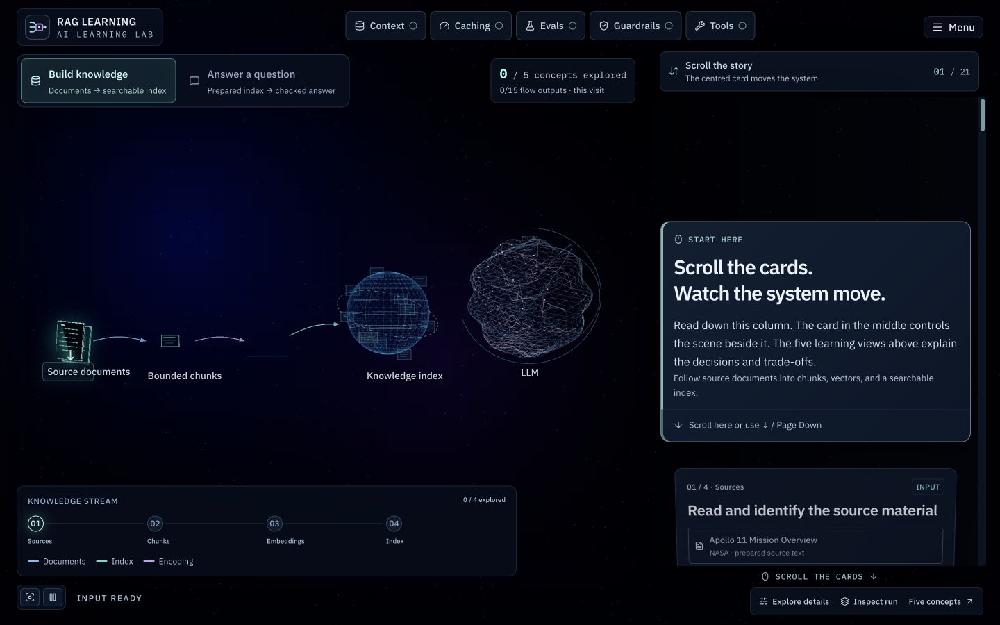
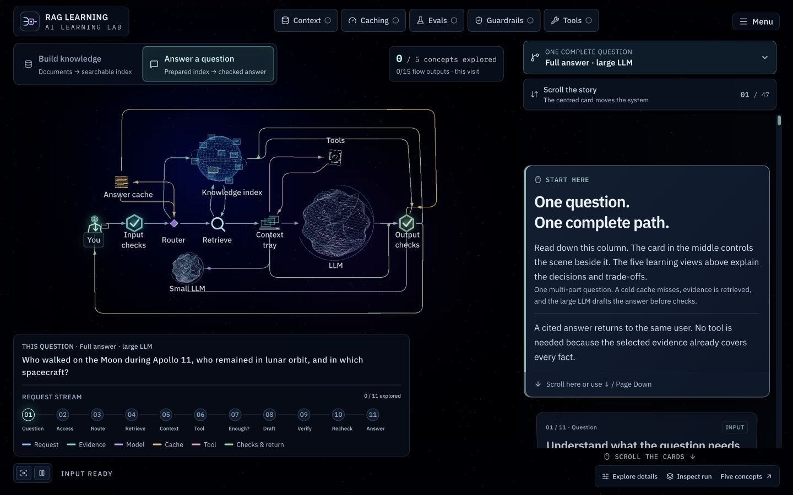
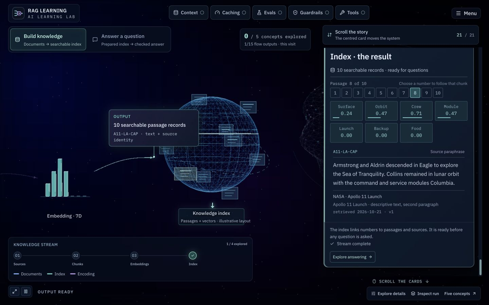
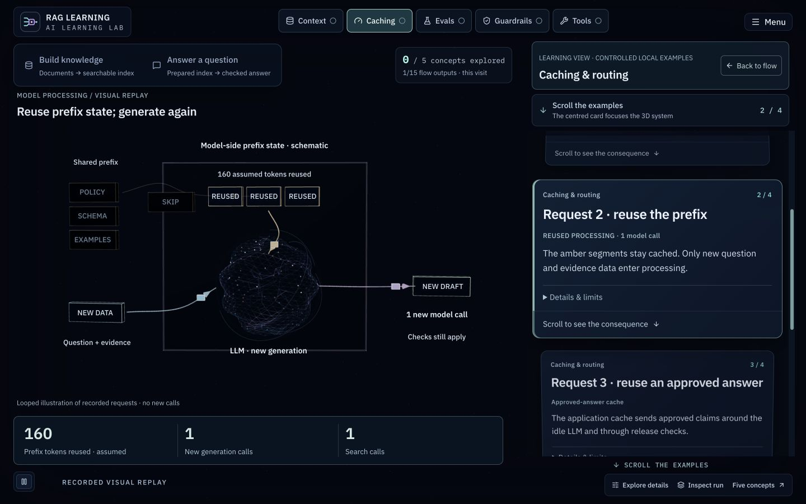
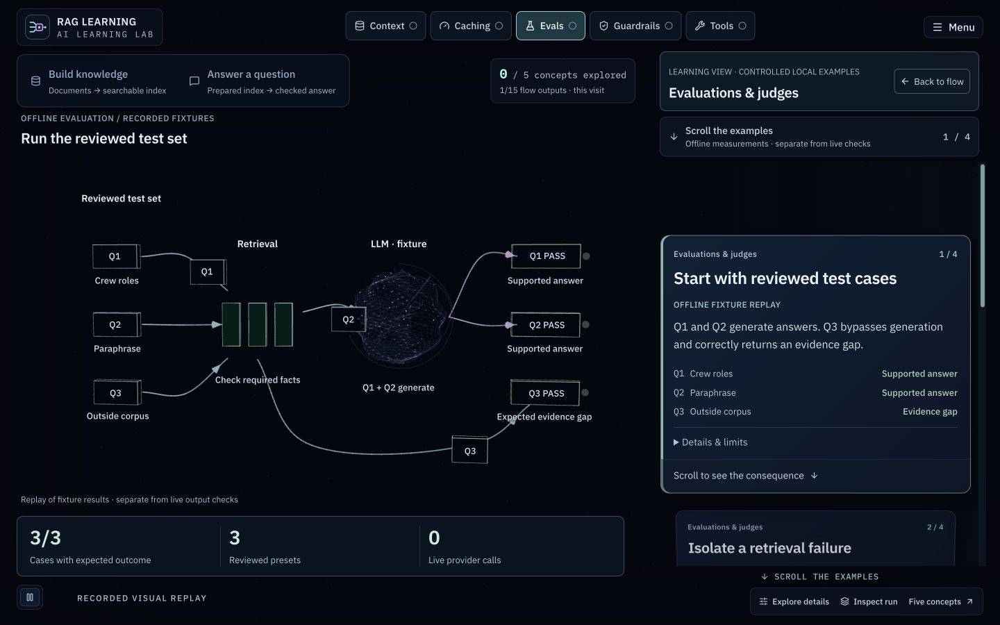
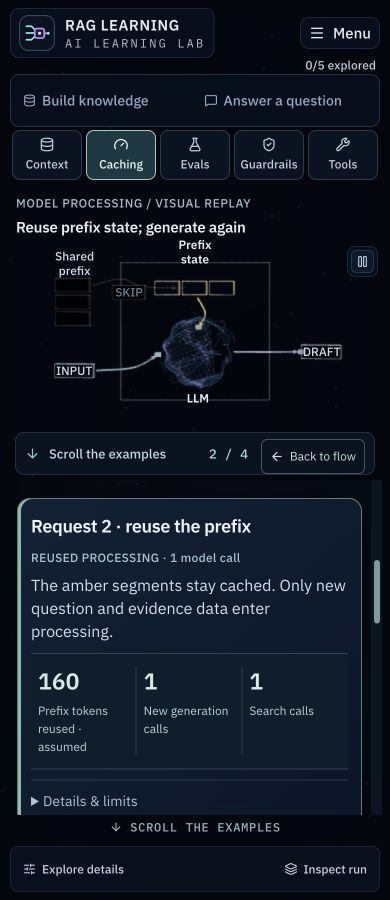

# RAG Engineering Lab

**Learn five practical AI engineering concepts by watching a RAG system work.**

[Open the live lab](https://rag-engineering-lab.lovable.app/) · [Lab guide](docs/LAB_GUIDE.md) · [Architecture](docs/ARCHITECTURE.md) · [Contributing](CONTRIBUTING.md)

[](LICENSE)


RAG Engineering Lab is an interactive educational website with a full-screen 3D system, moving documents and data packets, and a scrollable explanation beside it. The site brand is **RAG Learning · AI Learning Lab**.

Build a knowledge index, follow a question to its checked answer, and inspect the decisions that make an AI application grounded, efficient, measurable, and controlled. The examples run locally from reviewed fixtures: **no API keys, paid model calls, or database required**.



## The five learnings

- **Context — RAG and embeddings:** follow source text into chunks, seven-dimensional toy vectors, and an index; compare exact words with semantic features and inspect retrieved evidence.
- **Caching and routing:** watch a cold prefix become reusable model-side state. A warm prefix still produces a new draft; an approved-answer cache hit takes a separate bypass. Compare small/large model selections and fictional work units.
- **Evaluations and judges:** watch labelled test cases move through retrieval, generation, and scoring. Separate missing-evidence failures from unsupported answers, and compare a claim with its source using a simulated judge rubric.
- **Guardrails and permissions:** inspect input screening, untrusted document instructions, output schemas, citation support, access denial, and release-time eligibility. Model-response checks and application permissions have different jobs.
- **Tools and context:** follow a validated source-passage read and see what survives a context budget. This is a bounded application workflow; the lab does not assume RAG needs an autonomous agent.

## Build or review your own RAG application

Use the **[reusable RAG engineering agent prompt](prompts/rag-engineering-agent.md)** with your coding assistant. Copy the whole file into a conversation, or place it in your target application and explicitly ask the assistant to read it. It is independent of this lab's UI, fixtures, stack, and example data.

Choose **REVIEW** to validate an existing system, **DESIGN** to work from architecture and requirements, or **BUILD** to implement a grounded application or prioritized fixes. The prompt assesses all five areas, requires project-specific evidence and acceptance checks, and distinguishes essential boundaries from optional caching, routing, judges, and agents. It does not certify production readiness from a checklist or a simulated score.

[Copy-and-paste examples and usage guide](prompts/README.md). No agent framework or plugin is required, and the file does not replace your project's existing instructions.

## Try the lab

1. Choose **Build knowledge** or **Answer a question**. Both streams are independent and available immediately; the answer stream uses a prepared fixture index.
2. Scroll the visible card column. The centred card selects the scene and shows its input, operation, or output. On mobile, the cards sit below the scene.
3. Open **Context**, **Caching**, **Evals**, **Guardrails**, or **Tools** for controlled examples. **Back to flow** restores your place in the current stream.
4. Use **Explore details** for configuration and comparisons, or **Inspect run** for the execution report and citations.

Each step shows **Input → Change → Result**. Scenes settle while you read; scrolling continues the story. Balanced graphics uses less rendering work, with optional High detail. Caching and evaluation illustrations play once and can be replayed. Pause, reduced-motion, and static low-effects views are supported. Exploration progress counts what you have viewed during this visit and resets on a fresh load. [Performance changes and browser verification](docs/PERFORMANCE.md).

### One complete question flow

The question map uses an aligned request spine, compact paired service lanes, and separate model and answer-return corridors. Rounded bends stay within their routing lanes, while consistent arrow sizes and restrained zoom keep the 3D flow readable.



<details>
<summary>Completed knowledge index and source records</summary>



</details>

### Prompt caching in the scene

Prefix segments remain in schematic model-side state while variable input enters the LLM and a new draft leaves it. The result strip distinguishes reused prefix tokens, new generation calls, and searches.



### Evaluations in the scene

The test deck sends Q1–Q3 through the evaluation bench. A correctly handled unanswerable case bypasses generation and passes its expected evidence-gap outcome. Other examples isolate retrieval failures, generation faults, and judge verdicts.



These images are captures of the running app. [Screenshot notes and refresh instructions](docs/screenshots/README.md).

<details>
<summary>Mobile prefix-learning view</summary>



</details>

## Run locally

Use **Bun 1.4.0** and the committed `bun.lock`. A recent Node.js LTS installation is recommended for the Vite/TanStack tooling.

```sh
git clone https://github.com/ArifMehmood16/rag-engineering-lab.git
cd rag-engineering-lab
bun install --frozen-lockfile
bun run dev
```

Open the URL printed by Vite. To choose an explicit local address:

```sh
bun run dev -- --host 127.0.0.1 --port 5173
```

No environment file or model-provider credentials are required. The install policy in `bunfig.toml` enforces a 24-hour minimum package age; preserve it when changing dependencies. Use Bun for reproducible installation rather than mixing package managers in one checkout.

### Verify and build

```sh
bun run test
bunx tsc --noEmit
bun run lint
bun run build
bun run preview
```

Tests cover deterministic engine outcomes, evidence/citation checks, cache behaviour, tool permissions, story continuity, gallery position, and learning-view isolation. They do not establish model quality or learning effectiveness. The Lovable/TanStack build writes `.output/`; use the printed preview address to inspect the production build.

## How it works

The app uses **React 19, TypeScript, TanStack Start/Router, Three.js, React Three Fiber, Drei, Tailwind CSS, and Vitest**. There is no live model integration or vector database.

- `src/content/`: lessons, reviewed source records, scenarios, and synthetic fixtures.
- `src/lib/`: pure request engine, retrieval, caches, metrics, permissions, and recorded scene states.
- `src/components/lab/`: scroll gallery, 3D worlds, accessible readers, and inspectors.
- `src/components/learn/`: lesson renderers and interactive explanations.
- `src/routes/`: file-based application routes.
- `src/test/`: behaviour and regression tests.
- `prompts/`: portable instructions for designing, building, and validating your own RAG application.

The live request path and the offline evaluation bench are separate. Animation observes stored snapshots; replaying or reverse-scrolling does not call a model or alter recorded results. [Architecture and data flow](docs/ARCHITECTURE.md).

## Demonstration boundaries

Keyword scoring, explicit toy vectors, cosine similarity, ranking, in-memory cache checks, permissions, and fixture metrics execute locally. Learned embeddings, model generation, routing quality, provider prompt caching, and LLM judging are **simulated**. Token counts are estimates; work units are fictional, with no real latency or pricing claim.

Apollo 11 is a familiar example corpus, not the subject of the app. Source records retain URLs, locators, versions, and excerpt/paraphrase labels. Synthetic adversarial and fault cases are identified separately. EvidenceLens is a design-phase case study for applying the concepts; this lab does not demonstrate its production implementation or validation.

## Documentation

- [Reusable RAG engineering prompt](prompts/rag-engineering-agent.md) and [usage examples](prompts/README.md): evidence-based Review, Design, and Build modes across the five areas.
- [Lab guide](docs/LAB_GUIDE.md): complete streams, examples, controls, motion, and simulation details.
- [Architecture](docs/ARCHITECTURE.md): engine, snapshots, scene boundaries, and routes.
- [Contributing](CONTRIBUTING.md): setup, changes, verification, and screenshot workflow.
- [Attributions](docs/ATTRIBUTIONS.md): example sources, dependencies, fonts, and design references.
- [Project conventions](AGENTS.md): repository-specific implementation rules.

## GitHub and Lovable

The published app is [rag-engineering-lab.lovable.app](https://rag-engineering-lab.lovable.app/).

The repository is [ArifMehmood16/rag-engineering-lab](https://github.com/ArifMehmood16/rag-engineering-lab). Its linked [Lovable editor project](https://lovable.dev/projects/03c32535-dfe7-4d9d-8711-6602260deed2) is an editing workspace, not the public app URL.

Commits pushed to the connected branch sync to Lovable. Preserve published history: do not force-push or rewrite it. Repository topics cover RAG, AI engineering, caching, evaluations, guardrails, tool calling, and the interactive 3D stack.

## License

Original code and authored learning material are licensed under [Apache License 2.0](LICENSE), © 2026 Arif Mehmood. See [NOTICE](NOTICE) and [Attributions](docs/ATTRIBUTIONS.md) for third-party material, which retains its own terms.
