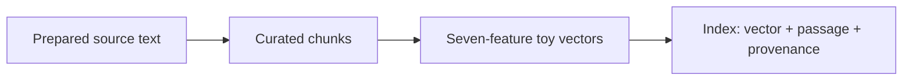
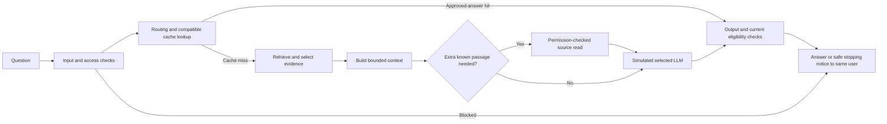

# Architecture

[Project overview](../README.md) · [Lab guide](LAB_GUIDE.md) · [Contributing](../CONTRIBUTING.md)

RAG Engineering Lab is a deterministic teaching application. React renders the interface; pure TypeScript modules calculate the example results. TanStack Start provides routing and build/SSR integration. No model service, external vector store, or application database is needed.

## Two independent streams

The knowledge stream illustrates preparation before a question is asked:

The question stream starts independently with the prepared index. A simplified view of its branches is:

This diagram groups related stages for readability; `ENGINE_STAGES` and `advance` in [`apollo-engine.ts`](../src/lib/apollo-engine.ts) define the actual order and early stops. Routing selects a generator profile before it runs. A prefix-cache hit reuses assumed prefix processing but does not bypass generation. An approved-answer hit can bypass retrieval, tools, and generation while still requiring current release checks.

## State and rendering

1. [`apollo.ts`](../src/content/apollo.ts) supplies reviewed source records and labelled synthetic fixtures. [`rag-scenarios.ts`](../src/content/rag-scenarios.ts) describes isolated request examples.
2. [`apollo-engine.ts`](../src/lib/apollo-engine.ts) advances one operation at a time and retains its inputs, outputs, usage, claims, checks, and outcome.
3. [`rag-scroll-story.ts`](../src/lib/rag-scroll-story.ts) prepares exact replay snapshots. [`rag-gallery.ts`](../src/lib/rag-gallery.ts) maps the centred reading card to a story moment.
4. [`RagWalkthrough.tsx`](../src/components/lab/RagWalkthrough.tsx) retains independent stream positions. [`RagWorld.tsx`](../src/components/lab/RagWorld.tsx) and its HTML reader render the selected snapshot.
5. Reverse scrolling reviews stored state; ambient movement never executes an engine operation. Current scene state must not expose facts from a later snapshot.

Five concept views are immediately available alongside the streams. [`rag-learning.ts`](../src/lib/rag-learning.ts) prepares controlled examples independently of the active request. Opening or closing a learning view does not warm that request's caches or change its reading position.

## Question routing geometry

The request map has a level left-to-right spine: user → input checks → router → retrieval → context → LLM → output checks. Cache, knowledge index, and tools occupy reserved service positions; the small model sits on a lower branch near routing. Cache bypass, source rechecks, tools, model branches, and the return to the original user use separate corridors.

`flowRoute` supplies exterior object ports and shared bends. `travelPoint` trims and rounds each bend within that corridor instead of using a free spline that can overshoot it. The Three.js stroke, arrow, moving packet, projected annotation, and static SVG all use this geometry. A second spline must not be fitted through the sampled route. Arrowheads retain a stable screen size as the camera changes distance. Request close-ups retain neighbouring stations rather than greatly magnifying the background map.

The route regression checks cover object clearance for normal and stopping paths, bounded corners, distinct paired lanes, aligned station rows, and camera framing.

## Dedicated prefix and evaluation worlds

[`rag-theatre.ts`](../src/lib/rag-theatre.ts) derives scene models from completed fixtures. [`RagTheatreWorld.tsx`](../src/components/lab/RagTheatreWorld.tsx) renders physical prefix tiles, data packets, neural LLM illustrations, required-fact racks, case IDs, and result slots. [`RagTheatrePanel.tsx`](../src/components/lab/RagTheatrePanel.tsx) supplies short explanations, recorded result receipts, and per-mode SVG fallbacks.

The prefix scenes distinguish cold prefill, warm prefix reuse with a new draft, and an application answer-cache bypass. The evaluation scenes distinguish reviewed cases, a retrieval miss, unsupported generation with fixed evidence, and a simulated judge comparing source and claim. Evaluation observes completed results rather than becoming an operation in the live request path.

The clock drives only visual replay. It never increments call counts, changes cache state, advances a card, or modifies a score. Pause, reduced motion, a hidden page, and the details drawer freeze it. The LLM sphere and prefix store are schematic; they do not show hidden model reasoning or literal provider memory.

## Execution boundaries

- **Calculated locally:** word matching, explicit seven-feature vectors, cosine scores, ranking/selection, context budgets, versioned in-memory caches, permission/eligibility checks, fixture-based metrics, and a bounded source-passage read.
- **Simulated:** trained embedding/reranking quality, model generation, routing quality, provider cache internals/outages, and LLM judge verdicts.
- **Estimated:** token counts. Cost comparisons use fictional work units, not provider prices or measured response time.
- **Prepared:** source extraction and chunk boundaries. The app does not fetch and parse NASA pages during a run.

The source tool is an application-controlled local read of a known passage ID from the question. Code validates the arguments, access, and budget before adding its result to context. It is not an autonomous agent loop.

## Routes

- `/`: the 3D lab, independent streams, and five concept views.
- `/overview`: the lesson overview.
- `/lessons/$slug`: individual lessons with shared previous/next navigation.
- `/architecture`, `/roadmap`, `/writing`: cross-lesson learning pages.

The route implementations live in [`src/routes/`](../src/routes/). `routeTree.gen.ts` is generated; do not edit it manually.

## Accessibility, privacy, and integration

The readable HTML gallery remains usable with wheel, touch, arrow keys, and Page Down. Reduced motion removes card depth and camera easing. Low effects selects static illustrations. Essential results remain readable beside the scene, or below it on narrow screens.

Visitor text, notes, and quiz answers are not collected by the lab. Run configuration, cache state, and viewed-stage/concept counts are held in memory and reset on a fresh lab load. The page loads web fonts from Google Fonts. Existing Lovable preview hooks can report runtime errors when the editor provides them; they are separate from the simulation engine.

[`vite.config.ts`](../vite.config.ts) retains the Lovable/TanStack integration and excludes Three.js scene modules from DOM source-tag injection. Preserve that compatibility hook when introducing another 3D module. The build emits `.output/`; this project is not a plain static `dist/` Vite site.
