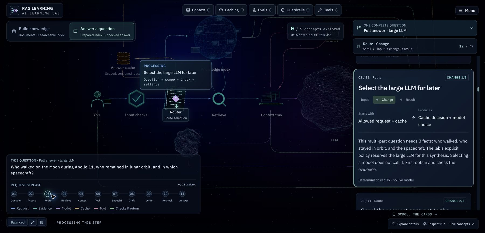

# Browser performance

[Project overview](../README.md) · [Architecture](ARCHITECTURE.md)

## What changed

The lab keeps its 3D worlds and two independent streams, but stops redrawing an unchanged scene while someone reads.

- Stream transitions request frames for 2.5 seconds after a new card, scroll position, camera mode, or inspected passage. The scene then rests until the next interaction. The camera no longer drifts indefinitely.
- Balanced graphics is the default: pixel ratio capped at 1.25 and scheduled transition frames at 30 FPS. High detail raises these to 1.75 and 60 FPS. Text remains ordinary HTML at browser resolution. React updates, scrolling, and resizing can also request frames.
- Caching and evaluation examples play once, then retain their result. Each packet completes its own path, with delayed departures instead of a wrapping clock. Replay visual example replays only the illustration, never the engine or cache.
- Pause, reduced motion, hidden tabs, and the details drawer cancel scheduled animation. Reduced motion keeps a static equivalent, with deliberate scrolling still selecting the recorded step.
- `ResizeObserver` measures label dimensions when their size changes. Animation writes compositor translations instead of interleaving layout reads with `left`/`top` writes for every label.
- Connections retain rounded-route samplers and arrow tangents. Hidden packets skip position updates. The normal render path bypasses the postprocessing composer when no transfer glow is needed.
- Mostly opaque reading surfaces no longer blur the moving background. Tall cards begin at their headings; quieter card tilt preserves the gallery without moving the text excessively.

The canvas still uses demand rendering. Do not add a per-frame `invalidate()` loop: that would undo the reading-time savings.

## Verification on 21 October 2026

Compared a saved, unchanged production build at `1cfe18d` with the optimized production build containing `2b0e5b0`, `623230f`, and the final control/label fixes in `b566415`. Both used Chrome on the same laptop, with DevTools Performance monitor open, an unthrottled connection, and a **1139 × 867 CSS-pixel viewport**. Neither run used the Pause control to obtain its reading-time result.

- **Knowledge, unchanged:** spot CPU readings of 19.6–24.2%; about 509–600 layouts/second.
- **Question map, unchanged:** spot CPU readings of 60.6–63.6%; about 1,356–1,403 layouts/second and 1,436–1,441 style recalculations/second.
- **Knowledge, optimized and settled:** 0.1% reported CPU, zero layouts/second and zero style recalculations/second.
- **Question map, optimized and settled:** 0% reported CPU, zero layouts/second and zero style recalculations/second.
- **Prefix and evaluation examples, optimized after completing:** 0.1% reported CPU and zero layouts/second/style recalculations/second for each. The final production browser check recorded no runtime errors.

The unchanged canvas was 1993 × 1517 drawing pixels; Balanced rendered 1423 × 1083 at the same CSS size. That is approximately 49% fewer drawing pixels, not a measured 49% reduction in GPU time.

These are DevTools spot readings, not a cross-device benchmark, a whole-machine CPU percentage, a GPU power measurement, or a learning-outcome study. Browser extensions and other open apps were present. Heap readings varied with navigation and garbage collection; no memory-leak conclusion was drawn. The earlier published-site review used a different run and produced different CPU percentages; it is not mixed into this local comparison.

## Repeat the check

1. Build with `NITRO_PRESET=node-server bun run build`, then run `PORT=5176 HOST=127.0.0.1 node .output/server/index.mjs`. This local preset does not change Lovable's deployment configuration.
2. Open Chrome DevTools → command menu → **Show Performance monitor**. Keep viewport size, browser zoom, graphics setting, extensions, and monitor configuration consistent between revisions.
3. Wait for the WebGL scene to load fully. Leave the knowledge introduction selected for at least 10 seconds, then record CPU, layouts/second, and style recalculations/second. The lab tab must remain selected and visible.
4. Repeat for Answer a question. Scroll to a work card and confirm that the camera, documents, and active transfer respond; leave it unchanged and confirm that activity settles again.
5. Open Caching and Evaluations, allow 20 seconds for each recorded illustration to finish, and check that the result remains readable with no continuing animation. Replay should restart the illustration and then settle again.
6. Check pause/resume, reduced motion, a hidden tab, the details drawer, and switching streams. Neither stream should lose its selected card or reading position. A fresh load resets exploration counts.

The verified suite contains 120 passing tests. TypeScript and the production build pass; ESLint has no errors and ten pre-existing Fast Refresh warnings. The render-budget tests use fake time to verify settling, cancellation, wake-up, pause/resume, and finite visual replays. Geometry and story tests continue to check route clearance, complete-question handoffs, cache semantics, and learning-view isolation. CPU measurements require a real browser; unit tests alone do not establish them.
